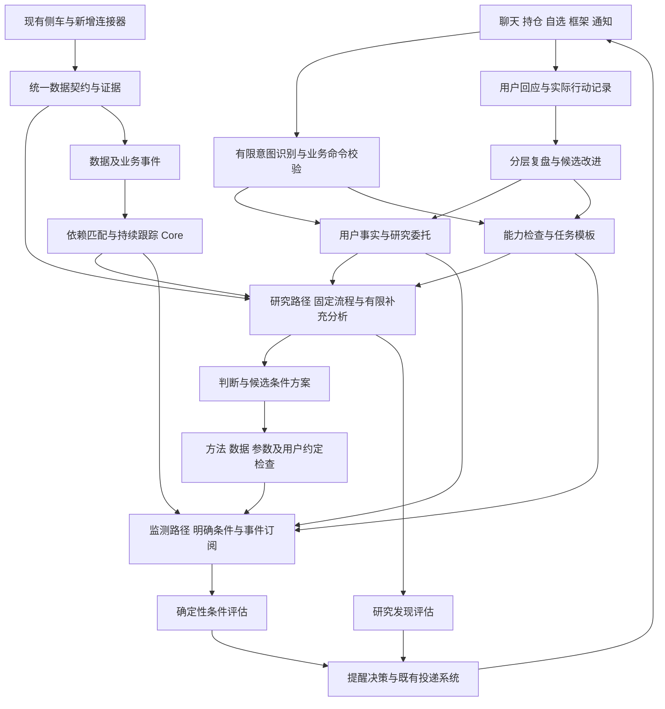
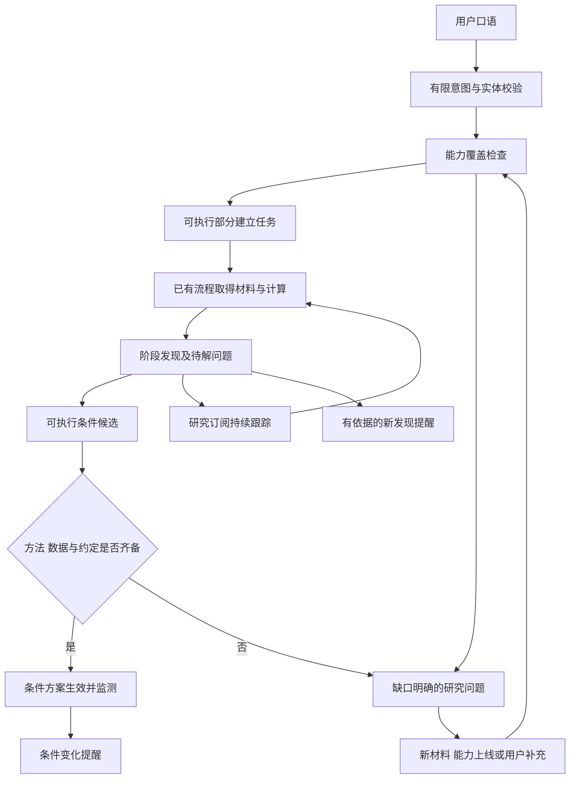
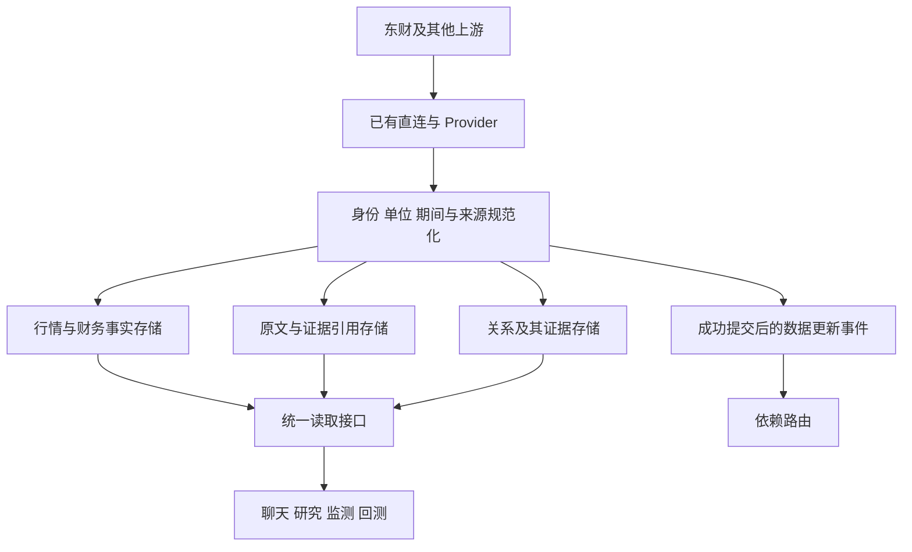
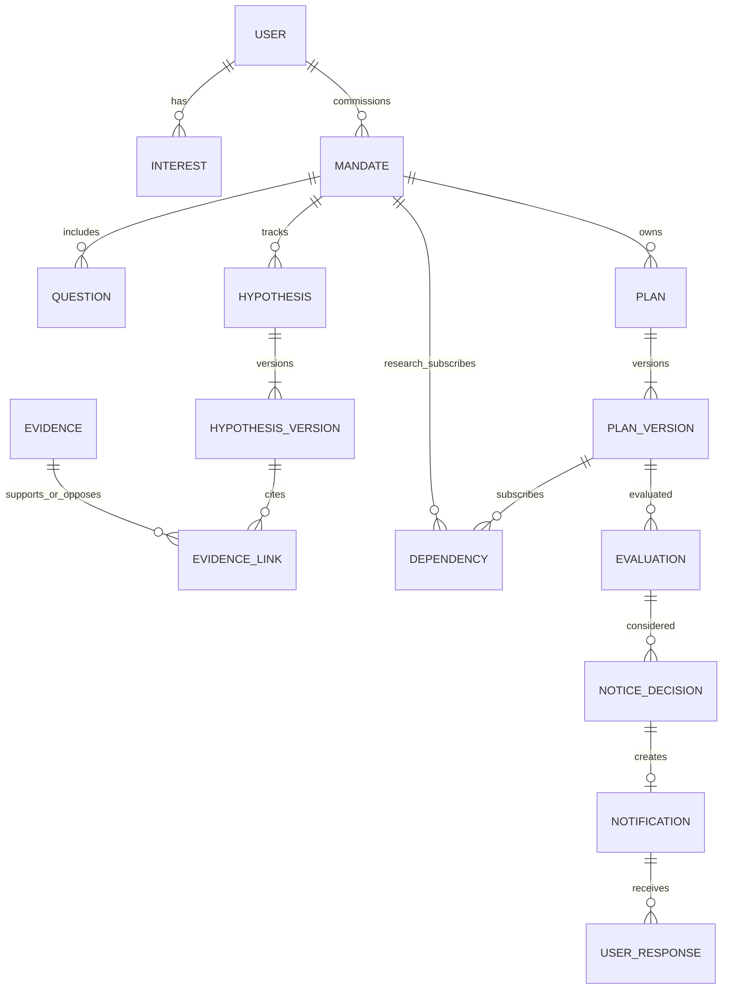
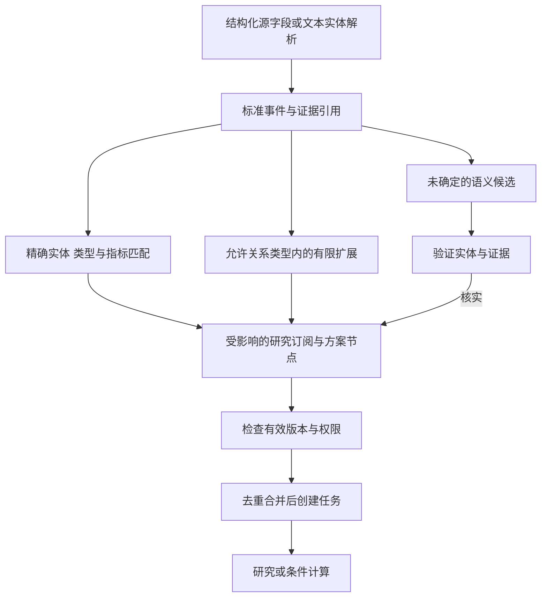
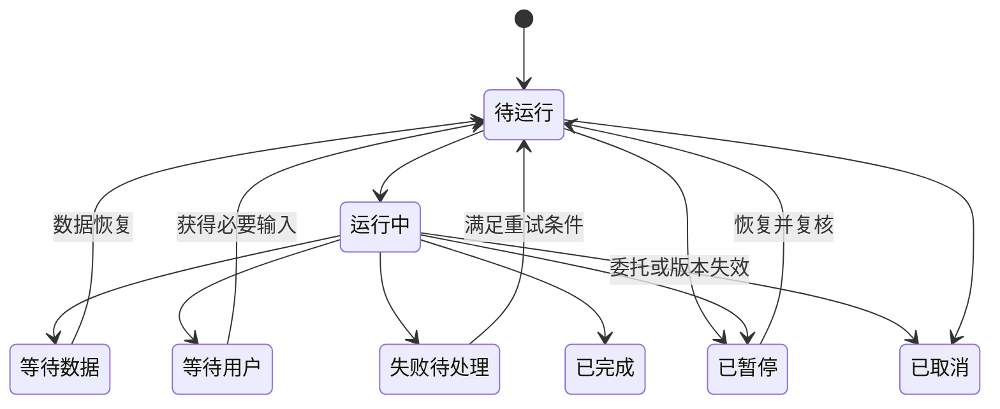
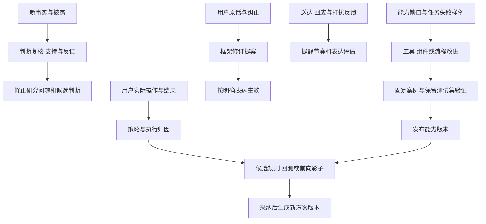

评审稿，2026 年 10 月 16 日。面向产品与工程团队。

本方案建设面向 A 股个人投资者的中短线投研伙伴：用户自然表达研究需求，系统保存委托，在两次对话之间持续取得相关证据，执行已支持的分析与条件检查，并在有意义的变化出现时提醒用户。研究判断、用户选择、实际操作与后续结果分别进入反馈。

实施起点采用少量基础工具、计算组件和固定研究流程，不依赖模型一次完成复杂规划，也不要求提前穷举所有投资策略。PG 保存业务状态、版本与证据引用，程序负责计算、事件匹配与状态推进，模型承担有限意图识别、材料提取和开放性分析。当前无法执行的部分明确保存为研究问题或能力缺口。

本文是独立的新设计文档，保留[原总体设计评审稿](https://chatgpt.com/space/page_e410a482dd448191b5f6ab7f644a0428)和[原升级汇报方案](https://chatgpt.com/space/page_4a05da22343c8191a5e23d0a371a3b76)。其中“现有基础”指本地代码盘点，不代表新版已实施或线上接口已验收；其余能力清单、数据模型与流程为目标设计。

# 1 产品目标与本次架构调整

产品服务用户持续数周至数月的研究、等待和持有过程，具体期限由委托定义。技术指标保留为分析与执行工具，公司经营、行业证据、估值及个人约束共同进入研究。服务周期延长不直接代表收益提高，价值要通过复核效率、遗漏、提醒质量与反馈可追溯性验证。

用户继续使用同花顺等熟悉工具观察大盘、技术走势、资讯和交易；伙伴承接研究委托、持续跟踪和复盘。产品自身保有完成委托所需的数据和计算能力。上述分工不意味着已有第三方集成、自动读取其他应用或自动下单。

前台保留持仓与自选、聊天、用户投研框架、框架验证与演进、通知五类能力。用户框架是偏好、关注点、委托、判断、方案和历史的组合视图，不是一段由模型反复整体改写的长提示词。

| 架构议题 | 本方案采用的边界 |
| - | - |
| 口语进入系统 | 有限意图识别、实体解析、能力检查，再进入固定任务模板 |
| 任意需求的处理 | 支持的部分先执行，不支持的部分保存明确缺口，不虚构工具或监测能力 |
| 研究与监测 | 开放研究与明确条件监测并行，研究成果满足要求后才转入条件方案 |
| 工具与策略 | 基础工具、计算组件、研究流程、用户条件方案分层，避免为每种话术写一个工具 |
| 模型的作用 | 提取、解释和提出候选；程序持有事实、状态、生效规则和通知权限 |
| 反馈与演进 | 判断、策略执行、用户框架、提醒质量分别评价；能力改进不静默替换个人约定 |

首阶段聚焦个股委托，支持少量可靠流程。全市场主动发现、广泛产业链传播、自动编写并执行新策略代码、自动交易均不作为首阶段前提。

# 2 总体架构与模块职责

先在现有 Python 后端内建立模块边界，由 API 承接交互，Worker 执行持久任务。逻辑模块不等于独立部署服务；负载和隔离需求明确后再拆分。

| 模块 | 权威职责 | 主要边界 |
| - | - | - |
| 用户事实与行为 | 持仓、自选、明确偏好、行为与关注点 | 浏览不等于买入意愿，手工交易不伪装成券商成交 |
| 聊天接入与委托 | 意图、业务命令、跨会话研究目标 | 模型产出先校验；重试不重复创建委托 |
| 能力与研究执行 | 能力目录、固定流程、工具调用、阶段结果 | 只调用已注册能力；无能力时登记缺口 |
| 数据与证据 | 标准身份、来源、指标口径、披露与采集时间 | 共享市场材料与用户私有信息隔离 |
| 条件与方案 | 版本、条件树、计算结果与依据 | 通用策略、用户方案、评估结果分开 |
| 持续跟踪 Core | 事件路由、到期检查、任务租约与恢复 | 只有一个任务状态所有者，模型不持有调度状态 |
| 提醒决策与投递 | 发送、合并、延后、抑制及渠道投递 | 评估成立不自动等于需要打扰 |
| 反馈与演进 | 判断复核、规则验证、用户纠正、提醒效果 | 候选改进经过验证和适用范围检查再采用 |

任务、证据、评估和提醒使用稳定标识关联；各模块通过业务接口访问，避免跨模块直接改表。

# 3 从一句口语到持续服务的责任清单

用户示例：“帮我关注科士达，看看现在的位置，什么时候值得进一步考虑买入，有什么风险。”这是流程示例，不包含当前个股判断。

早期模型只需提出有限意图和槽位，例如对象名称、历史位置、风险复核、入场条件需求、是否持续跟踪。用户身份由服务端确定，证券身份由主数据解析，模型不能编造内部 ID。

| 步骤 | 输入与输出 | 执行责任 | 不满足条件时 |
| - | - | - | - |
| 1 接收请求 | 原话与会话变为可追溯请求 | 聊天 API | 保留请求 ID，幂等重试 |
| 2 识别有限意图 | 提出对象、需求类型、持续性 | 模型提取加 Schema 校验 | 降为普通问答或仅澄清关键歧义 |
| 3 解析研究对象 | 名称代码变为公司和证券 ID | 主数据及别名查询 | 返回候选供确认，不取模糊匹配第一项 |
| 4 读取用户事实 | 取得当前持仓、约束、已有委托 | 业务服务精确读取 | 缺失保持未知，不从聊天猜持仓 |
| 5 检查可用能力 | 需求映射为可执行和受阻部分 | 能力目录及规则 | 登记具体工具、数据或方法缺口 |
| 6 建立委托与问题 | 保存目标、范围、来源和状态 | 委托服务 | 已明确部分可先生效，不强迫填完整问卷 |
| 7 生成初始任务 | 选择固定流程及参数 | 模板路由器 | 不允许模型凭空生成函数名 |
| 8 取得数据与计算 | 证据快照、确定性指标 | 连接器和计算执行器 | 局部等待、有限重试或缩小范围 |
| 9 研究与解释 | 带依据的发现、反证和待解问题 | 模型加输出及引用校验 | 无新证据停止本轮，不制造完成结论 |
| 10 建立跟踪 | 生成研究订阅或明确条件方案 | 能力检查、用户约定及依赖生成器 | 不能自动化的判断保留为研究问题 |
| 11 后台运行与提醒 | 增量评估和提醒决策 | Core、条件执行器、通知服务 | 旧版本失效、重复事件抑制、发送前复核 |
| 12 回应与复盘 | 回应、操作关联、结果和改进 | 业务记录与复盘流程 | 未回应不算接受，接受不算成交 |

“帮我关注”可以建立明确范围内的研究跟踪。由模型新提出的仓位上限、买卖阈值或风险偏好修改属于候选，需由用户明确采纳后生效；不重复确认用户已经明确委托的动作。

原有“每次研究都必须生成交易方案”的隐含前提取消。委托可以长期只有研究订阅，没有生效的买卖条件。

# 4 基础工具清单

基础工具负责读数据、取得材料或提交受控业务命令。以下 ID 用于设计映射，不表示接口已上线。“复用封装”指已有相关代码，仍需确认契约与覆盖；“扩展”指存在基础但缺少目标行为；“新增”指当前盘点未发现对应完整能力。

| ID 与能力 | 输入与输出 | 现有基础及处理 | 首阶段范围 |
| - | - | - | - |
| T01 实体解析 | 名称代码到公司、证券、别名及歧义 | 行情身份与公司清单，扩展标准身份 | 必需 |
| T02 用户事实读取 | 用户账户到持仓、自选、交易及来源 | holdings、watchlist、trades，复用封装 | 必需 |
| T03 当前框架读取 | 用户委托到偏好、问题、方案和版本 | 会话上下文为基础，扩展 | 必需 |
| T04 历史行情读取 | 标的、窗口、时点、复权到行情序列 | market-watch 及分析侧 Provider，复用封装 | 必需 |
| T05 行情快照与日历 | 标的及时间到可用行情、交易日和新鲜度 | market-watch，复用封装 | 必需 |
| T06 财务事实读取 | 公司、指标、报告期、截至时点到财务事实 | 财务 Provider 路径，核对口径后扩展 | 覆盖合格的指标先接入 |
| T07 披露材料读取 | 公司和时间范围到公告列表、正文及引用 | 新闻与材料入口，正文覆盖需核对 | 无正文时明确限于线索 |
| T08 新闻检索 | 对象、问题和时间到去重材料与出处 | 现有新闻聚合，复用封装 | 限定来源与预算 |
| T09 关系查询 | 实体及关系类型到有来源的关系边 | industry-chain，扩展时点与可信类型 | 先支持已核实直接关系 |
| T10 历史证据检索 | 委托及问题到旧材料、判断和结果 | 现有报告加新证据关联，扩展 | 先精确 ID 与全文检索 |
| T11 验证任务提交 | 策略版本及范围到回测或影子任务 ID | backtest_tasks、shadow，复用封装 | 仅已有可执行规则 |
| T12 业务命令提交 | 经校验的委托、暂停、候选变更到提交结果 | 现有业务服务扩展 | 写入权限与幂等必需 |

每个工具记录输入和输出结构、数据时效、来源、超时、成本边界、错误类型、读写权限与实现版本。工具成功返回 HTTP 状态不等于数据齐全；必须同时返回覆盖情况和缺失项。

T12 的业务命令由服务端校验和执行。模型不能直接写 PG、发送通知、修改持仓、调用任意网络地址或执行任意代码。

连接器与能力分离：T04 可以由不同数据源提供，但上层仍调用同一行情契约。新增来源应提高具体问题的覆盖、时效或可靠性。

# 5 计算组件清单

计算组件由代码实现。阈值、窗口、口径和输入快照显式保存；缺失值与执行错误不能转为零。下面的方法是实现范围建议，不能把尚未实现的 ID 暴露为可调用工具。

| ID 与组件 | 核心输入和输出 | 边界与验收 |
| - | - | - |
| C01 覆盖与新鲜度检查 | 必需字段、时点、有效期到覆盖和缺失原因 | 尚未披露、获取失败、不支持、过期分别返回 |
| C02 期间对齐与单位转换 | 原始指标到统一期间、币种、单位和口径 | 不混用单季与累计、合并与母公司数据 |
| C03 价格分位 | 同口径历史序列和窗口到分位与样本量 | 并列值规则、最小样本与修订行为固定 |
| C04 回撤与持续时间 | 价格序列和窗口到当前及历史回撤 | 说明是价格回撤或组合净值回撤 |
| C05 相对表现 | 标的与基准的对齐序列到相对收益 | 比较期、交易日和收益口径一致 |
| C06 指标变化 | 可比指标到同比、环比或绝对变化 | 分母为零、负数及不可比时明确不适用 |
| C07 估值位置 | 合适估值序列到历史或同行分位 | 无历史披露时点数据不做历史策略验证 |
| C08 仓位与暴露 | 账户快照、价格和分母定义到集中度 | 区分成本与市值、证券资产与总资金，缺失不猜 |
| C09 事件与关系匹配 | 标准实体、事件类型和关系路径到命中记录 | 关联只触发复核，不直接推出经营影响 |
| C10 三值条件组合 | 满足、不满足、未知到 AND、OR、NOT 结果 | 未知不能被过滤掉，也不能视为无风险 |
| C11 时间窗口与状态转换 | 事件序列到持续满足、首次进入或重新进入 | 使用明确交易日历，处理迟到与修订事件 |
| C12 重复与提醒门槛 | 评估变化、已提醒状态到发送或抑制理由 | 冷却、暂缓、静默、失效和版本检查可测试 |

首阶段优先 C01、C03、C04、C09、C10、C11、C12；C08 只在持仓及分母可靠时启用。C02、C06、C07 随财务和估值数据覆盖逐步启用。代码中已有技术指标和模拟计算可以复用，但不能仅因名称相近就认为符合这里的口径。

“经营改善”“竞争优势增强”等宽泛判断不属于单个确定性计算组件。能操作化的窄命题可以用组件验证；开放判断保留支持、反证和不确定性，通过研究流程推进。

# 6 研究流程与用户条件方案清单

研究流程组织基础工具与计算组件。早期路由从有限模板中选择，不让模型自由规划任意工作图。模板内可允许有限的补充取证，例如最多若干轮材料查询；预算参数由产品配置并经试点确定。

| ID 与流程 | 组合及阶段产物 | 重新执行条件 |
| - | - | - |
| R01 个股初次研究 | T01 至 T05，按覆盖补 T06 至 T09；C01、C03、C04；产出身份、历史基线、问题清单和已建立订阅 | 用户委托、范围改变、关键数据修订 |
| R02 披露变化复核 | T07、T08、T10，必要时 T06；C01、C02、C06、C09；产出相对旧判断的新增支持、反证和待核实项 | 相关披露、证据修订、材料补齐 |
| R03 持仓条件检查 | T02、T03、T05；C08、C10 至 C12；产出条件结果、风险与提醒候选 | 持仓变化、约定行情更新、方案变化或到期 |

R01 可以只完成历史位置与研究建档；没有财务证据时不能输出完整经营判断。R02 无正文或可定位材料时只登记线索并继续取证。R03 没有有效条件方案时读取持仓事实和整理问题，不擅自生成止损阈值。

后续按真实缺口增加财务质量复核、估值情景、行业指标研究和主动候选发现。新增流程需要输入要求、完成条件、反例、预算和恢复方式；不以提示词数量作为方法库规模。

| ID 与用户条件方案 | 可执行部分 | 生效要求与提醒含义 |
| - | - | - |
| P01 历史位置观察 | 价格分位或回撤进入约定范围 | 方法窗口与口径明确；提示观察条件满足，不称为买点 |
| P02 关键披露复核 | 公司发布某类材料或指标发生指定变化 | 明确研究问题；先触发研究，不直接判断利好或利空 |
| P03 持仓风险检查 | 已确认的价格、集中度或其他风险条件 | 持仓可信、阈值和作用范围明确；返回依据和可选动作 |
| P04 到期研究复核 | 约定日期或时长到达，检查证据与问题 | 无变化安静留痕；长期受阻提出缩小、替代、暂停 |
| P05 复合机会观察 | 数值条件、证据条件、用户约束及风险门槛组合 | 仅支持已实现的条件；必需判断未知时不宣布整体满足 |

用户方案绑定流程或组件的具体版本，不与通用策略混用。关注兴趣不能直接生成买卖方案；回测通过也不自动代表用户采纳。

一个条件节点可以声明方法 ID、版本、输入、输出字段、比较符和阈值。它是程序配置，不是让模型解释执行的自然语言。早期采用有限节点集合及参数校验；复杂的自动方案编译放在后续阶段。

# 7 能力目录与模型使用边界

能力目录登记已实现能力、试验能力和缺口。只有已发布且当前可用的能力进入模型候选集；“计划开发”不能被当作可执行工具。

| 目录字段 | 用途 |
| - | - |
| capability_id 与版本 | 唯一定位工具、组件或流程 |
| kind 与实现引用 | 区分工具、代码组件、固定流程和受控模型步骤 |
| 输入输出 Schema | 校验类型、必填项、单位和输出字段 |
| 适用范围与依赖 | 标的范围、数据覆盖、依赖组件及前置条件 |
| 权限与副作用 | 读、写、是否需明确采纳、幂等规则 |
| 运行边界 | 超时、次数、成本预算、重试类型 |
| 生命周期与验证 | 草案、试验、已发布、退役及测试证据 |
| 缺口与恢复 | 缺数据、缺工具、缺方法或用户含义不清及恢复条件 |

模型使用分为三类。有限意图提取以固定标签和原话片段为输出；材料提取要求回到具体文档和位置；开放分析输出研究发现与候选判断。三类任务分别评估，不能用 JSON 格式合法率替代研究正确率。

对成本较低或规划能力有限的模型，先提供少量当前适用工具、明确步骤和结构化输入。一次调用只承担可检验的小任务；无效输出有限修复后结束，不无限循环。是否升级到更强模型依据试点质量和预算决定，不预设任一具体型号一定满足要求。

| 不具备的条件 | 系统行为 |
| - | - |
| 没有对应数据工具 | 保留研究问题，处理用户提供材料，登记能力缺口 |
| 数据暂时获取失败 | 有限重试，等待恢复事件；保留其他已完成部分 |
| 有数据但没有对应算法 | 可提供资料研究，不宣称已建立自动量化监测 |
| 开放判断尚未操作化 | 保存支持和反证，接入研究订阅，不直接成为买卖门槛 |
| 模型不可用 | 确定性监测和任务状态继续运行；语义分析进入等待 |
| 模型输出与证据不符 | 拒绝提交相关判断，保留错误和复核记录 |

完整方案编译器不是首阶段前置条件。先实现受限模板路由、条件节点校验和依赖生成；随着可执行方法和真实案例积累，再增加有限组合能力。

# 8 数据接入与共享证据架构

现有数据获取分布在 market-watch、分析侧 Provider 和 industry-chain。目标是统一身份、口径、来源、更新事件和读取接口，使同一数据能力服务聊天、研究、监测和验证。第一阶段包装已有入口，不要求一次迁走所有采集代码。

东财是数据提供方之一，AKShare 是项目使用的获取工具之一，两条路径可能访问同一上游。直连东财与通过 AKShare 取得同一材料不能算两份独立证据。

| 数据域 | 必须统一的内容 | 存储与服务策略 |
| - | - | - |
| 主数据 | 公司、证券、上市市场、别名和发行主体关系 | 标准实体与来源 ID 映射 |
| 行情 | 交易日、价格单位、复权、时区、覆盖和修订 | 保留专用序列存储或现有缓存，统一读取契约 |
| 财务 | 指标、期间、合并口径、币种、披露及修订 | 保存来源事实与标准值，不以新值覆盖历史证据 |
| 公告新闻 | 原始发布者、提供方、正文或片段、时间和内容哈希 | 长文放文件或对象存储，PG 存元数据和引用 |
| 产业关系 | 关系类型、方向、来源、有效期、披露或推断属性 | 关系表先行；未核实关系只生成研究候选 |

统一证据返回至少包含对象、原始值、标准值、单位、报告期、披露时间、采集时间、源记录 ID、连接器版本、质量状态和缺失项。衍生指标另带计算版本及输入快照。

共享数据按对象采集一次，再路由给相关委托。不同用户权限不同的数据不能进入公共缓存。订阅取消后减少相关采集需求，公共资料的必要采集由平台策略统一管理。

历史验证同时保留披露时间与系统获取时间：真实运行回放按当时系统已取得的证据；研究回测若只依据公开披露时点，必须标明该假设，不声称复现真实运行。没有历史时点证据的定性判断转为前向观察。

# 9 PostgreSQL 中的用户偏好与关注点

用户偏好、兴趣和研究委托分别回答“服务应遵守什么要求”“用户关注什么及为何关注”“用户让系统做什么”。它们关联，但不互相替代。

## 偏好字典 当前值与变更历史

建议采用 preference_definitions、user_preferences、preference_changes 三类记录。模型提议的未确认变更存为业务命令草案或框架变更提案，不能直接覆盖当前值。

| 表 | 主要字段与 PostgreSQL 类型 | 约束 |
| - | - | - |
| preference_definitions | key text、schema_version integer、value_schema jsonb、validator_ref text、consumer text | key 与 schema_version 唯一；定义允许字段、单位和使用方 |
| user_preferences | user_id uuid、preference_key text、schema_version integer、value jsonb、source_message_id uuid、confirmed_at timestamptz、expires_at timestamptz、revision bigint | 用户和 key 唯一；定义复合外键；值由对应校验器检查 |
| preference_changes | id uuid、user_id uuid、key text、before_value jsonb、after_value jsonb、source_ref、actor、revision、created_at timestamptz | 按用户和 key 保留有序变更；与当前值及事件同事务提交 |

| 偏好 key 示例 | 结构化值示例 | 程序如何使用 |
| - | - | - |
| investment.horizon | 最短与最长天数 | 选择匹配研究周期的流程 |
| research.weekly_time_budget | 每周分钟数 | 控制研究摘要的安排 |
| portfolio.max_single_position | 比例及适用范围 | 起草组合约束；生效方案还需确定账户与分母 |
| communication.explanation_depth | beginner 等受控枚举 | 调整解释深度 |

通知静默时段和渠道由既有 notification_preferences 承接，不在用户偏好中建立第二份权威值。示例不构成默认投资参数。

JSONB 只保存一个偏好的小结构，用户身份、key、版本、生效与过期时间保持独立列。PG 的 JSON 类型检查不等于业务 Schema 校验；服务层校验、数据库约束和事务分别承担职责。对高频计算的稳定金融字段，可在专属业务表使用明确的 numeric 列，而不是反复从任意 JSON 中解析。

“我怕亏”保留为表达与待澄清问题，不能自动变成某个回撤阈值。默认值需要标明系统默认，不伪装成用户确认。更新使用 revision 比较，冲突后重读；过期偏好停止应用但保留历史。

## 关注点及证据

建议 user_interests 保存当前关注，interest_evidence 保存依据，entity_aliases 支持标准实体解析。

| user_interests 字段 | 类型与含义 |
| - | - |
| id、user_id、entity_id | uuid；分别关联记录、用户、标准实体 |
| purpose | text；learning、opportunity、holding_management 等受控值 |
| origin_kind | text；explicit 或 inferred |
| status | text；candidate、active、paused、revoked |
| confirmed_at | timestamptz；推断候选可以为空 |
| last_observed_at、expires_at | timestamptz；活动与有效期 |
| revision | bigint；并发控制 |

用户、实体、目的构成唯一组合。同一公司可以同时存在学习和持仓管理关注；具体委托范围由 mandate_subjects 另行关联。

interest_evidence 保存原话、消息或行为事件的引用、支持类型、发生时间、归纳方法版本。数值化活跃度仅用于排序或候选提示，不代表真实购买意愿，也不能覆盖明确偏好。推断可衰减，用户已确认的关注不应仅因近期没点击就被撤销。

用户纠正“只是帮别人看”后撤销相应推断，刷新派生摘要和检索索引。用户已卖出也不自动代表不再关注；持仓变化与研究意愿分别维护。

# 10 业务表与数据所有权

以下是目标逻辑实体，不要求首阶段逐项建独立物理表。已有模块保留标识和权威来源；只有需要独立生命周期、查询或可靠事务的对象才拆表。前端组合视图不另建一份权威框架。

| 领域 | 建议逻辑表 | 所有权与处理 |
| - | - | - |
| 账户资产 | investment_accounts、positions、trade_records、watchlist_items | 资产模块；承接现有数据，不重复维护持仓 |
| 偏好关注 | preference_definitions、user_preferences、preference_changes、user_interests、interest_evidence | 用户框架模块；明确值与推断分开 |
| 用户行为 | behavior_events | 行为模块；浏览记录可有损、有限留存 |
| 会话命令 | conversation_bindings、agent_commands | 聊天模块；引用现有消息，不复制聊天系统 |
| 研究委托 | research_mandates、mandate_subjects、research_questions | 委托模块；跨会话目标与暂停状态 |
| 框架变更 | framework_revisions | 框架模块；记录变更对象、依据和采纳，不复制整个世界 |
| 研究判断 | research_hypotheses、hypothesis_versions | 研究模块；保留当时命题、支持和反证 |
| 条件方案 | condition_plans、plan_versions、plan_evaluations | 条件模块；版本不可原地改写，评估关联输入快照 |
| 能力目录 | capability_definitions、capability_versions、capability_gaps | 执行模块；分别覆盖工具、组件、流程及待补能力 |
| 主数据来源 | entities、entity_aliases、data_sources、source_mappings | 数据模块；区分公司、证券和上游身份 |
| 证据关系 | source_documents、observations、entity_relations、evidence_links、ingestion_cursors | 数据模块；行情大序列可继续在专属存储 |
| 事件路由 | domain_events、event_keys、tracking_dependencies、event_matches、event_consumptions | Core；保留因果和匹配理由 |
| 可靠发布 | event_outbox | 业务提交侧；可与 domain_events 合并物理实现 |
| 持久任务 | research_jobs、research_job_steps | Core；租约、检查点、预算和重试 |
| 提醒决策 | notification_decisions | 通知模块；保存发送、抑制和延后的理由 |
| 通知投递 | notifications、notification_events、delivery_jobs、delivery_attempts、notification_preferences、notification_audit | 复用现有通知仓储与状态机 |
| 反馈验证 | user_responses、action_links、validation_runs、outcome_reviews、improvement_proposals | 反馈模块；验证索引引用现有回测和影子结果 |

原 method_versions 的职责在这里由 capability_versions 中的组件与流程版本承接，不建立两套重复目录。validation_runs 是不同验证结果的统一索引，不再实现第二套回测任务系统。

研究订阅可直接归属委托或研究问题，无需先有 PLAN。ER 图表达业务关系；用户回应也可直接来自聊天，不必先有通知。通知可合并多个决策，物理设计需用关联表或既有事件关系表达，不按图强制限制为一个决策来源。

PG 中对用户归属、方案版本和任务建立外键、唯一键及索引。私有对象的关联要校验同一用户，不能只验证对象 ID 存在。服务端从认证上下文取得 user_id；共享证据与私有材料明确访问范围。向量检索和摘要只做派生索引，不决定现行规则。

首阶段数据库迁移以可靠闭环为单位：新委托、条件、任务与事件可进入 PG；旧资产和通知先通过现有接口接入。涉及资产变更可靠触发时，要么迁到同一事务边界，要么使用可恢复日志与对账补偿。普通 JSON 文件锁不提供 JSON 与 PG 跨存储原子提交。每项实体始终只有一个权威写入方。

# 11 事件识别与追踪依赖如何关联

依赖匹配由两端共同生成标准化键完成。方案或研究模板声明关心什么，数据采集与业务提交声明发生了什么，程序按实体、事件类型、指标和权限范围查询受影响任务。

## 依赖从哪里来

| 来源 | 生成的依赖 |
| - | - |
| 价格位置组件 | 目标证券的日线更新、历史行情修订 |
| 财务变化组件 | 目标公司的指定指标更新、报告披露 |
| 披露复核研究订阅 | 公司公告、相关已核实主题与旧判断关联材料 |
| 持仓条件 | 用户及账户的持仓变化、指定行情更新 |
| 到期复核 | 委托或方案的到期时间 |
| 关系研究 | 允许类型和方向的关系边、关联主体事件、关系变更 |

这些依赖由流程和组件的声明生成，模型可以提出候选研究范围，但不负责每条事件到来时临时猜关联。

## 事件怎样取得标准身份

优先使用结构化来源提供的公司代码、证券代码、公告主体或指标 ID。自由文本经过名称抽取、别名查询和消歧得到候选实体；不确定的匹配保留原文片段与原因，进入研究队列，不能直接触发交易条件。

公司与证券通过发行主体关系关联，财报发布到公司，价格更新到证券。主题标签用于扩大研究候选，不把同属行业直接等同于利润影响。

| 表 | 核心字段 |
| - | - |
| event_keys | event_id、subject_id、event_type、feature_key |
| tracking_dependencies | id、user_id、mandate_id、可选 plan_version_id、node_id、subject_id、event_type、feature_key、scope_key、active、rule_version |
| event_matches | event_id、dependency_id、match_kind、relation_path、reason、created_at |
| event_consumptions | consumer_id、event_id、状态、处理时间及错误 |

委托拥有者始终存在；plan_version_id 只在条件方案依赖中必填。scope_key 区分公共行情事件与个人账户事件。对公共资料的匹配仍需校验材料访问权限。

例如“公司 A 的经营现金流指标更新”会匹配订阅公司 A、该事件类型和该指标的节点。该节点重新计算，不需要模型阅读所有用户历史。

关系扩展限定类型、方向、有效期和最大层数，保存具体路径；两条路径指向同一事件不重复计为独立证据。关系增加、修订或失效时发送关系变更事件并重建依赖，避免订阅长期停留在旧图谱。

语义检索可以帮助召回未直接提及公司的政策或新闻，但只是候选路径。覆盖不完整时无法保证全量发现；通过人工标注事件集、已知漏报和定期有限复核评价召回率。正常增量匹配与补偿检查配合，避免一次漏事件导致永久失联。

# 12 后台运行 用户行为与失败恢复

用户行为分为三类采集。前端浏览、曝光与点击使用有限留存的 telemetry；成功创建委托、暂停方案、确认修改等由业务服务提交可靠事件；交易与持仓从现有权威接口读取并保留手工、导入或同步来源。点击交易按钮不是成交证据。

后台采用三种运行方式：相关事件到达时增量执行，到期时复核，离线任务按游标聚合行为和评估质量。离线分析可以提出关注候选、流程改进和提醒调整，不直接改写风险偏好或生效方案。

系统推荐形成的曝光和用户自主搜索需分别标记，避免“推荐某行业—用户看了—认定用户更喜欢该行业”的自我强化。已存在的 shadow 策略参与不能当作用户真实交易偏好。

研究任务建议保存 mandate_id、可选 plan_version_id、trigger_event_id、input_snapshot_id、capability_version、status、next_run_at、lease_token、lease_expires_at、attempt_count、checkpoint、budget、last_error、cancel_generation。任务以事件及节点版本等组合键去重，消息允许至少一次到达，业务处理必须幂等。

图示为任务状态，不是投资判断状态。等待、失败、暂停中的任务也能被取消；委托结束或权限撤销优先于重试。达到预算后保存部分结果与具体恢复条件，不自动重复整份分析。

| 故障或变化 | 必须具备的行为 |
| - | - |
| 业务写入后进程退出 | 同事务 outbox 或可恢复变更日志，消费可补偿 |
| Worker 重启或租约过期 | 从检查点恢复，持过期租约者不能提交状态 |
| 用户修改或暂停 | 版本或取消代数递增；提交和发送前检查，旧结果只留历史 |
| 数据迟到或修订 | 保存原版本并重评受影响节点，必要时更正先前提醒 |
| 模型失败 | 确定性结果仍保存；模型步骤进入等待或失败 |
| 多来源重复材料 | 按原始材料及修订去重，保留不同出处 |
| 无新增证据 | 安静结束本轮，更新检查记录和下次恢复条件 |
| 长期缺少证据 | 提出替代指标、缩小问题、暂停或结束的具体方案 |

业务暂停可立即阻止新调度和新提交；已经进入外部渠道的消息可能无法撤回，必须保留投递状态并避免承诺绝对撤回。后台跟踪要求宿主服务运行；本地部署关闭整个应用或主机后，不能宣称仍在运行。

# 13 条件语义与提醒决策

研究发现与确定性条件是两种不同的提醒来源。研究发现需要可定位的新证据及其对原问题的影响；条件提醒必须对应有效方案、输入快照与确定性评估结果。两种路径共用提醒决策，但不能把模型分析包装成程序已经证实的买卖信号。

| 条件类型 | 评估依据 | 输出边界 |
| - | - | - |
| 数值 | 指定公式、单位、窗口和阈值 | 数据有效才进行比较 |
| 事件 | 已识别的主体、事件类型和原始材料 | 事件发生与利好利空解释分开 |
| 窄命题判断 | 明确可观察指标与支持反证标准 | 固定指标不自动推广为整个公司判断 |
| 开放判断 | 支持材料、反证、提取及分析版本 | 默认作为研究发现，不能直接自动买卖 |
| 关系 | 已核实关系和允许路径 | 关联不等于影响方向、幅度或因果已成立 |
| 时间与状态 | 交易日历、持续时间、持仓及方案状态 | 使用明确时点和当前有效版本 |
| 统计情景 | 固定假设、样本、参数及适用范围 | 输出依赖假设，不能伪装成确定预测 |

三值语义：AND 中任何必需项不满足则整体不满足，全部满足才满足，其余未知；OR 中任一项满足则满足，全部不满足才不满足，其余未知；NOT 未知仍为未知。执行错误独立保存。机会条件不能因为缺失项被跳过而成立。

风险检查独立运行。某个已确定风险不应被其他数据缺失压住；机会方案要求风险门槛时，风险未知也不能被当作已排除风险。具体门槛按方案定义，不用一条总分掩盖缺失与反证。

| 提醒处理 | 条件与用户体验 |
| - | - |
| 安静记录 | 无实质变化、无关或重复材料，留痕不打扰 |
| 汇总 | 有进展但不紧迫，进入用户约定摘要 |
| 轻敲 | 与委托直接相关、存在新增依据且值得此刻处理 |
| 风险提醒 | 约定风险成立，按已设置渠道与优先级发送 |
| 能力或数据问题 | 只在实质影响正在依赖的跟踪、需要用户行动时说明 |

notification_decisions 保存关联评估、变化前后、用户与方案版本、发送或抑制理由、去重键、暂缓及失效时间。已投递内容复用现有通知中心；系统任务日志进入运维渠道，不直接转换成用户提醒。

重复条件采用首次进入、显著变化、重新进入或约定升级规则。冷却与静默时段是程序配置，模型不自行决定无限催促。发送前检查委托、方案、权限、数据时效与用户暂缓状态。

每条主动提醒回答“与你哪项委托有关、发生了什么、依据和限制是什么、现在有哪些可选动作”。同一条件成立不等于用户应立即交易，任何回应也不自动写成成交。

# 14 反馈机制与能力演进

原反馈设计中的策略归因、用户画像归因、卡片与提醒效果归因继续保留，增加明确的投资判断复核。通用策略经过验证并被个人方案采用后，通过 Core 在对应条件出现时服务用户。

| 评价对象 | 证据 | 允许的改进 |
| - | - | - |
| 投资判断 | 当时命题、后续事实、支持与反证 | 修改问题、适用范围和观察指标 |
| 策略与执行 | 回测、样本外、影子、实际操作及偏离 | 提出参数或条件候选，验证后采纳 |
| 用户框架 | 明确表达、纠正、操作理由 | 更新关注或偏好；收益不能替用户改变风险意愿 |
| 提醒效果 | 送达、重复、相关性、漏报与打扰反馈 | 节奏、合并、渠道与解释方式 |
| 共享能力 | 覆盖缺口、错误、耗时、成本、失败案例 | 迭代连接器、计算组件和研究模板 |

action_links 保存实际操作与方案或提醒的关联依据，区分用户确认、直接操作关联和系统推测。真实成交、用户手工记录、影子交易和资产修订分别标识。没有可靠关联时不能把后续收益归功于提醒。

定性研究用当时记录的判断和后续披露复核，不能强行套用收益回测。数值策略使用同口径历史、样本外与影子验证；缺少历史可得数据时只做前向观察。保留失败候选，避免多轮试验只展示最优者。

共享能力更新保留实现和模型版本。当前任务和个人方案固定引用版本，新版本影响既有语义时提出迁移候选，不静默修改用户约定。共享评估使用公共、合成或经允许的脱敏材料，私有持仓与聊天不进入其他用户上下文。

# 15 伙伴交互与主动发现

交互以“张嘴委托、拍肩提醒”为核心。用户在熟悉工具中看盘后，可以通过名称、代码、链接或主动提供的材料带入研究；语音和跨应用入口按实际平台能力另行建设，不假设系统能读取当前屏幕。

| 用户入口 | 需要稳定呈现的内容 |
| - | - |
| 聊天 | 已接受范围、已完成部分、具体缺口、下一次触发条件 |
| 持仓与自选 | 当前事实、来源、修订与跟踪关系 |
| 用户框架 | 偏好、关注目的、判断、约定及其变更依据 |
| 验证与演进 | 候选与生效分开，显示验证范围和限制 |
| 通知 | 为什么此刻提醒、原委托、依据和可选操作 |

IP 是业务状态的表达层。倾听对应输入，思考对应实际运行任务，审慎对应重要不确定性，轻敲对应允许打扰的通知；失败、暂停、取消或输出被打断时退出相应动作。保持可收起、减少动态效果和文本替代，非紧急提醒不抢焦点。具体页面与动效实施继续遵循仓库 DESIGN.md 和界面交付规范。

主动发现放在后续：固定来源更新后先用结构化条件筛选，再与用户明确目标及关注候选匹配，只对少量候选展开研究。发现候选先进入摘要或研究列表，用户愿意深入时建立新委托；不能自动加入持仓或开启买卖方案。

用户结果按问题组织，先呈现变化、影响及下一步，再展开证据与计算口径。来源数量增加不要求用户认识更多供应商；同一材料的重复转载不增加证据强度。关键时效、缺失和限制靠近结论展示。

# 16 现有能力复用与已知缺口

代码盘点基线为本地提交 2775c7675d。下列路径用于定位已有实现，代码存在不代表外部数据当前可用，也不代表目标业务链已贯通。仓库根目录为 /Users/xiexin/project/pa-investment-research。

| 用户动作 | 当前状态所有者或入口 | 缺口与处理决定 |
| - | - | - |
| 维护资产和自选 | adapter/store.py、manual_trades.py、trades_store.py | 扩展：来源、账户隔离、可靠事件；保留唯一资产事实 |
| 通过使用行为理解用户 | local_telemetry.py、behavior_profile.py | 扩展：关注目的与依据；不能用影子参与冒充真实交易 |
| 聊天后继续原研究 | research_chat_context.py | 新建：跨会话委托；复用现有会话关联和 revision 约束 |
| 获取市场数据 | market_watch/quotes.py、data_source_manager.py、providers/base_provider.py | 组合：现有获取能力接统一契约，覆盖与运行状态另验 |
| 跟踪事件和公司 | market_watch/events.py、industry_chain/universe.py、graph.py | 扩展：标准身份、关系有效期及委托依赖匹配 |
| 按条件检查 | market_watch/rules.py、position_risk.py | 扩展：三值组合、通用条件节点与明确用户方案 |
| 持续后台运行 | scheduler.py、backtest_tasks.py、shadow_tasks.py | 扩展：持久研究任务、依赖、预算、租约和检查点 |
| 收到提醒 | notifications/repository.py、service.py | 扩展：提醒决策与评估关联；复用投递、重试和去重 |
| 验证与演进 | strategies.py、shadow\.py、evolution.py、decision_recorder.py | 扩展：判断与个人方案版本、真实操作关联 |

adapter 路径前缀为 backend/dsh-trading-core/adapter/；分析侧数据路径前缀为 backend/dsh-trading-core/tradingagents/dataflows/；market_watch 位于 backend/market-watch/market_watch/；产业链位于 backend/industry-chain/industry_chain/。

现有主要资产和策略数据使用 JSON 集合，通知仓储使用 SQLite。PG 是本方案的目标业务存储选择，不能把目标表名描述为已经存在的数据库表。

实施前必须处理三个具体语义差异：

- market_watch/rules.py 当前评估会过滤缺失条件再进行 AND，不能直接承担新方案的三值语义。

- 策略 active、回测任务完成、验证通过和用户采纳是不同状态，接入时分别映射。

- 当前新闻事件主要做公司抽取与持仓自选匹配，还不是标准化的委托依赖路由。

原图中的 events_ledger 用于事件类别与候选标的积累，不能因名称相同就替代新的业务事件总线。DecisionRecorder 的模型决策也不能当作用户实际成交。

# 17 分期实施与验收清单

## 先完成一个可恢复的个股委托闭环

第一阶段串行打通口语识别、标准实体、研究委托、R01 初次研究、研究订阅及一种简单的明确条件、持久任务、提醒决策、既有通知投递和用户回应。以 R02 披露复核与 R03 持仓条件作为相邻流程按数据覆盖接入，不要求三条流程一开始全部具备所有财务或估值能力。

只建首条链真正使用的表和能力。首批能力目录可由代码声明，PG 保存发布版本和运行引用；复杂管理界面、独立图数据库、全市场发现和自动代码生成不作为前置工作。

| 阶段 | 建设内容 | 推进门槛 |
| - | - | - |
| 基础闭环 | 标准身份、委托、R01、明确条件、任务和通知反馈 | 一个真实样例能跨会话跟踪、重启恢复、暂停停止新提醒 |
| 研究扩展 | R02、覆盖合格的财务组件、R03、反证与复核 | 材料可定位、未知处理正确、已知事件召回可测 |
| 验证演进 | 原策略与新方案绑定、前向观察、候选比较与采纳 | 结果有版本、基线和失败记录，不静默更新用户约定 |
| 主动发现 | 固定来源筛选、兴趣匹配、摘要与拒绝反馈 | 新候选与目标相关，增量价值超过新增打扰 |

## 工程验收

| 用例 | 应观察到的结果 |
| - | - |
| 用户名称有歧义 | 提供正确候选，不默选；已明确请求不丢失 |
| 模型生成不存在的工具 | 调用被拒绝，保存能力缺口，不伪造成功 |
| 只支持部分需求 | 已支持任务继续，缺口有具体恢复条件 |
| 两个必需条件中一个缺失 | AND 不得宣布满足，缺失原因可追溯 |
| 行业新闻仅语义相似 | 先作为候选，未核实前不直接触发机会提醒 |
| 同一事件重复或迟到 | 幂等处理，修订触发正确重评 |
| 关联关系新增或撤销 | 依赖同步更新，旧路径失效 |
| 用户暂停且旧任务随后完成 | 旧结果不覆盖新状态，不进入新投递 |
| Worker 中途退出 | 租约与检查点恢复，无重复业务副作用 |
| JSON 资产提交后事件发布失败 | 日志或对账恢复事件，不能永久漏跟踪 |
| 模型服务关闭 | 已有数值和时间规则继续运行，语义任务明确等待 |
| 通知失败重试 | 评估不重复执行，渠道尝试可追溯 |
| 用户接受建议但无交易记录 | 只记录回应，不产生虚构成交或收益 |
| 用户纠正关注目的 | 当前关注及派生索引更新，不自动改变持仓 |
| 跨用户引用对象 | 服务及数据访问检查拒绝，公共材料复用不泄露私有事实 |
| 页面与 IP 状态 | 展示真实进度，停止时退出动作，可从通知回到原研究 |

PG 约束、并发提交、持久任务和投递必须通过真实数据库及跨层用例验证；本设计中的字段示例不能直接当作已验证迁移脚本。

## 模型与投研效果验收

建立固定真实口语样例、歧义样例、缺数据样例、反证样例与能力不支持样例，保留不参与调优的测试集。分别测量意图正确率、实体正确率、无效工具调用、证据提取准确性、反证遗漏、任务完成度与单位委托成本。

提醒评估包含相关性、及时性、重复与打扰，也包含已知重要事件的漏报。明确分母、标注标准和观察窗口，目标数值根据基线和试点再确定。不能只统计点击率或用模型自评发布新能力。

新数据源、计算组件、研究流程分别在固定问题和其他条件不变时比较增益。收益与风险表现需要更长观察，区分真实交易、影子、市场变化和用户操作差异。

# 18 迁移策略与待确认事项

迁移先保持现有持仓、自选、会话、策略和通知 ID，增加委托与方案关联。旧聊天不批量变为已确认约定，旧 active 策略不自动绑定用户，旧行为不推导新风险偏好。

新写入方启用前完成字段映射、数量与关键值核对、恢复演练和单写者切换。JSON、SQLite 与 PG 过渡期间，跨存储通知通过可靠日志和幂等消费者交接；不采用没有恢复机制的双写。回退时停新调度、取消待发送业务、保留新记录并按兼容方案读取，不能丢弃新用户数据。

先使用安静运行验证事件匹配、计算和提醒决策，再按用户或委托开启主动通知。运行观测包括来源新鲜度、解析失败、任务积压、租约恢复、缺口持续时间、被抑制原因、重复投递和模型成本。

进入实施前需要确认的产品与工程取舍：

1. 首条闭环是否采用个股初次研究加历史位置观察，随后接披露复核与持仓条件。

2. 首批数据源的正文、财务口径、历史时点和可用频率能支持哪些承诺。

3. 本地与服务端部署的后台运行边界，以及 PG 首阶段承担的实体范围。

4. 用户明确委托可直接执行的范围，新增条件与偏好何时需要采纳。

5. 提醒默认频率、静默、暂缓、风险升级与跨设备去重规则。

6. 初始模型在固定任务集上的质量、成本和降级方案。

7. 首阶段验收样例、试点范围与后续投入门槛。

架构设计批准后，再形成迁移脚本、接口契约与实施任务。此稿不执行代码改动、数据库迁移、发布或服务器操作。
