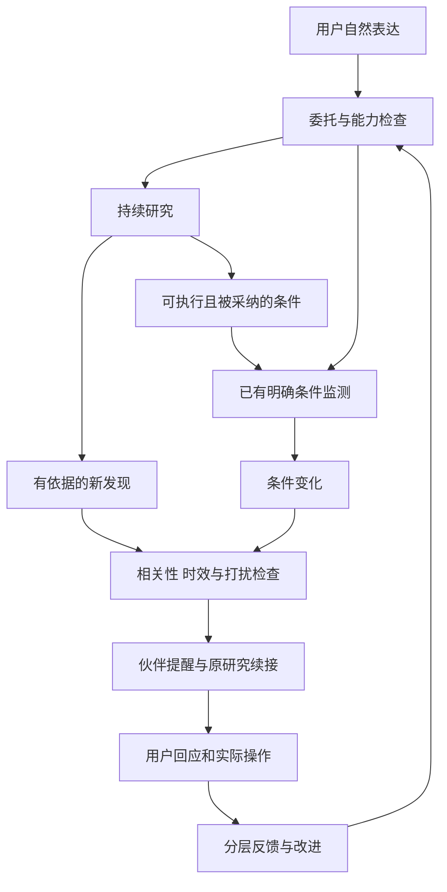

汇报稿，2026 年 10 月 16 日。

拟议升级方向是建设面向 A 股个人投资者的中短线投研伙伴。用户自然交代研究需求，系统在后台持续跟踪，并在研究有重要发现或约定条件发生变化时主动提醒。原有数据、策略、回测、影子验证和通知能力继续复用，反馈机制连接到用户实际研究与选择。

工程上从少量可靠工具、计算组件和固定流程开始。研究服务可以先成立，明确条件具备后再进入自动监测，不要求模型一次完成复杂规划，也不要求先建成庞大的方法库。

[配套能力清单与架构设计](https://chatgpt.com/space/page_a4fc860509dc8191b4fc398e3e87a4bf)。本稿独立于[原升级汇报方案](https://chatgpt.com/space/page_4a05da22343c8191a5e23d0a371a3b76)，原文保留。

# 1 为什么要升级

第一代产品已积累技术策略、分析、回测与影子验证能力，但用户得到策略后仍需要自己理解适用条件、关联个人需求，并持续等待和检查变化。产品容易停留在短线信号与结果展示。

中短线伙伴要补上三处连接：一次聊天形成持续委托；研究与策略绑定用户自己的条件方案；后台发现变化后在适当时刻带着依据找到用户。

中短线主要面向数周至数月的研究与持有过程，具体期限由用户需求决定。周期变化本身不保证收益改善，升级价值在于研究连续性、复核效率、少遗漏和可追溯决策。

用户仍可使用同花顺等熟悉工具看行情、技术走势和交易。我们承接随时交代的研究任务，以及两次看盘和聊天之间的持续跟踪；产品自身保有完成研究所需的数据能力。

# 2 最新方案的关键调整

| 议题 | 明确采用的方案 |
| - | - |
| 模型能力有限 | 先做有限意图提取，程序解析对象并匹配固定流程 |
| 初期工具不足 | 支持的部分先完成，缺口明确记录，不假装已建立监测 |
| 方法数量会不会失控 | 工具、计算组件、研究流程和用户条件方案分层复用 |
| 开放判断怎么处理 | 走研究路径，积累支持与反证；不强制量化成买卖信号 |
| 明确规则怎么执行 | 方法和数据具备后，程序计算、匹配事件并检查状态 |
| 长期后台怎么运行 | 持久任务、依赖索引、版本、恢复和提醒门槛由程序维护 |

研究与监测分成两条互相连接的路径。用户可以先得到材料研究、历史分析和变化跟踪；条件逐步明确并被采纳后，系统再承担相应自动监测。

# 3 用户如何感受到伙伴服务

用户说：“帮我关注这家公司，看看现在的位置，有什么风险，什么时候值得进一步考虑。”

系统确认研究对象，读取已有持仓与约束，说明能立即完成的分析和已建立的跟踪范围。缺少财务材料或方法时保留明确问题，不输出没有依据的完整判断。

随后有两类主动续接：

- 研究发现提醒：“新披露涉及你关注的问题，我整理了新的支持和反证。”

- 条件变化提醒：“我们之前约定的观察条件已满足，其他必需条件仍待确认。”

提醒可以展开到原研究、证据、条件和可选动作。用户可以暂缓、继续观察、调整方案或暂停。点击和接受不算成交，实际操作另行记录。

# 4 具体建设哪些能力

| 层次 | 配套设计清单 | 首期投入重点 |
| - | - | - |
| 基础工具 | 12 项，包含实体、资产、行情、财务、材料、关系和验证入口 | 包装已有接口，统一身份、来源和输入输出 |
| 计算组件 | 12 项，包含覆盖、分位、回撤、变化、条件、时间和去重 | 先做闭环必需组件，财务估值按覆盖扩展 |
| 研究流程 | 个股初次研究、披露变化复核、持仓条件检查 | 从一个流程打通，再接相邻流程 |
| 用户条件方案 | 历史位置、披露、持仓风险、到期复核、复合机会观察 | 只启用有方法、有数据、有明确约定的部分 |

这些是目标建设清单，不是已经上线的功能数量。核心投入是可复用数据和计算、持续任务状态、事件匹配与反馈，而非增加一批提示词名称。

数据接入优先复用东财及现有 Provider。共享接口让同一材料服务多个用户和场景；不同接入路径若来自同一上游，不算独立证据。新增来源要解决实际覆盖缺口，用户可追溯出处，但不必自己组织供应商。

PG 承接目标业务状态与任务；现有 JSON 资产、SQLite 通知按权威来源和可靠事件边界逐步接入。数据库表、框架描述、向量检索各有职责，不把整套用户框架放进一个长文本。

# 5 反馈机制如何接到用户

原有策略、画像、内容与预警反馈继续保留，并拆清评价对象：

| 回路 | 评价内容 | 可以改变什么 |
| - | - | - |
| 判断复核 | 新事实支持或反驳原判断 | 研究问题、观察指标与候选判断 |
| 策略与执行 | 回测、影子、实际操作及偏离 | 经验证的规则候选 |
| 用户框架 | 明确表达、纠正及操作理由 | 关注、偏好及个人约定 |
| 提醒效果 | 相关、及时、重复、漏报和打扰 | 节奏、合并、渠道和解释 |

进化后的策略通过验证并被个人方案采纳后，成为后台检查的依据，在对应时刻产生提醒。系统不静默替换个人方案，不因近期收益好就提高用户风险偏好。

另设共享能力改进：依据真实任务缺口补工具、修计算、完善流程，通过固定案例与保留测试集验证后发布。工具数量和模型自评不能替代质量证据。

# 6 交互变化与实施顺序

前台收敛为持仓与自选、聊天、用户框架、框架验证与演进、通知。聊天承接主要协作，伙伴 IP 表达真实任务状态，在需要时轻敲；专业事实与证据仍保留稳定入口。

语音、桌面唤起和跨应用集成可以逐步建设，不能默认读取其他软件或要求用户更换看盘工具。IP 状态由实际业务事件驱动，任务已暂停就不继续显示正在研究。

| 阶段 | 交付 | 验收重点 |
| - | - | - |
| 基础闭环 | 个股委托、初次研究、一类明确条件、持续任务和提醒反馈 | 跨会话继续、重启恢复、暂停有效、证据可追溯 |
| 研究扩展 | 披露复核、合格财务组件、持仓条件 | 反证可检查，缺数据不误报，相关事件召回可测 |
| 验证演进 | 新旧方案比较、前向影子、用户采纳 | 候选不静默覆盖，保留失败和基线 |
| 主动发现 | 固定来源筛选与用户匹配 | 新增价值可测，额外打扰受控 |

本地部署关闭整个应用或主机后不能继续后台运行；部署形态与服务承诺需一起确定。现有模块的代码基础与新闭环的上线验收分别管理。

# 7 评审与投入决策

首期需要确认：是否以个股初次研究加历史位置观察打通闭环；数据覆盖能支持哪些承诺；本地或服务端后台运行边界；提醒默认节奏；用户新增条件的采纳方式；模型基准任务集与验收标准。

验证分三层：程序正确性检查事件、版本、重试和计算；模型质量检查意图、引用、反证与不支持请求；产品价值检查复核耗时、提醒相关性、漏报、纠正成本和单位委托成本。指标目标根据基线与试点确定。

一项关键工程验收是：模型不可用时，已确认的数值规则、到期检查、任务恢复和通知去重仍然正常，只有语义分析进入等待。这能证明持续服务建立在程序和状态之上。

现有基础可复用，总体方案、清单与分期用于本次评审；具体排期需在首条链的接口、数据覆盖及迁移范围明确后估算。当前不将设计完成等同于开发、上线或验收完成。

# 8 口头汇报参考

这次升级要让现有分析和策略真正接到用户的投资过程里。用户今天说“帮我关注这家公司”，系统应该记住他为什么关注，在后续有新披露或约定条件变化时找到他，说明依据和可选行动。

我们不会把全部工作交给模型临时规划。早期先复用已有数据和工具，做少量计算组件与固定研究流程。开放问题持续研究，条件明确以后再进入程序监测。这样既能控制模型和工具不足的风险，也能让能力逐步积累。

交互上，用户继续用熟悉的看盘工具，有问题就向伙伴交代；伙伴平时安静跟踪，必要时拍一下肩膀。原来的反馈机制保留，但分别评价判断、策略、用户框架和提醒效果。

建议先证明一个完整个股委托闭环，验收跨会话跟踪、可靠恢复、有效提醒和反馈，再根据真实缺口扩展财务研究、策略演进与主动发现。
